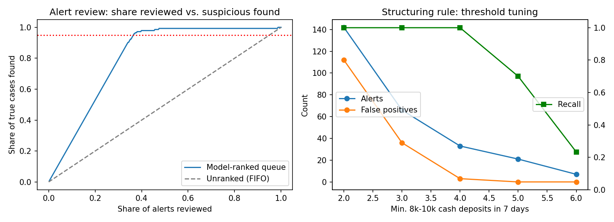

# AML Transaction Monitoring: SQL Scenarios + Alert Prioritization

A bank-style transaction monitoring workflow on synthetic data: six SQL detection scenarios, evaluation against a known answer key, threshold tuning, and a machine-learning model that ranks alerts so investigators review the riskiest cases first.

**Data:** synthetic, generated by `src/generate.py`. 5,000 customers (80% individuals, 20% small businesses), 189,701 transactions over 6 months. Six typologies are planted in 150 customers (3%). 300 legitimate look-alikes (cash-heavy shops, payroll payers, importers) are included on purpose so the rules produce realistic false positives.

## Scenarios (SQLite, `src/monitor.py`)

| Rule | Logic | Alerts | Precision |
|---|---|---|---|
| R1 Structuring | ≥3 cash deposits of $8,000–9,999 within 7 days | 66 | 0.45 |
| R2 Pass-through | Wire in ≥ $20k and ≥80% wired out within 2 days | 88 | 0.33 |
| R3 Fan-in | ≥10 distinct inbound counterparties within 7 days | 25 | 1.00 |
| R4 Fan-out | ≥10 distinct outbound counterparties within 7 days | 140 | 0.14 |
| R5 High-risk geography | Wires ≥ $10k to/from high-risk jurisdictions | 25 | 1.00 |
| R6 Dormant reactivation | First ≥ $15k transaction after 90+ inactive days | 62 | 0.42 |
| **All rules** | | **381 customers** | **0.38 (recall 0.96)** |

## Key results

- **Rules:** 96% of suspicious customers alerted (all six typologies except dormant reactivation, at 76%), at 38% precision. Payroll payers drive most fan-out false positives, importers most pass-through false positives.
- **Threshold tuning (structuring):** raising the minimum from 3 to 4 deposits cut false positives from 36 to 3 (−92%) with no loss of recall; at 5 deposits recall falls to 70%.
- **Alert prioritization:** a gradient-boosting model on behavioral features (volume vs. expected activity, in/out ratio, counterparty count, rule hits), scored out-of-fold with 5-fold CV, finds 95% of true cases after reviewing 139 of 381 alerts, a **64% cut in review volume**.



## Outputs

- `outputs/metrics.json`: all metrics
- `outputs/alert_queue_ranked.csv`: alerted customers ranked by risk score, with rule hits
- `outputs/structuring_threshold_tuning.csv`: alerts, false positives and recall by threshold

## Run

```bash
python src/generate.py   # writes data/customers.csv, data/transactions.csv
python src/monitor.py    # needs pandas, numpy, scikit-learn, matplotlib
```

## Limitations

- **Synthetic data with planted patterns.** The results show that the method detects these typologies; they are not evidence of real-world performance.
- Fan-in and high-risk-geography rules reach 100% precision only because no legitimate look-alikes were generated for them.
- The prioritization model is trained on the same answer key used for evaluation (out-of-fold, but still optimistic). Real SAR labels are noisier and delayed.
